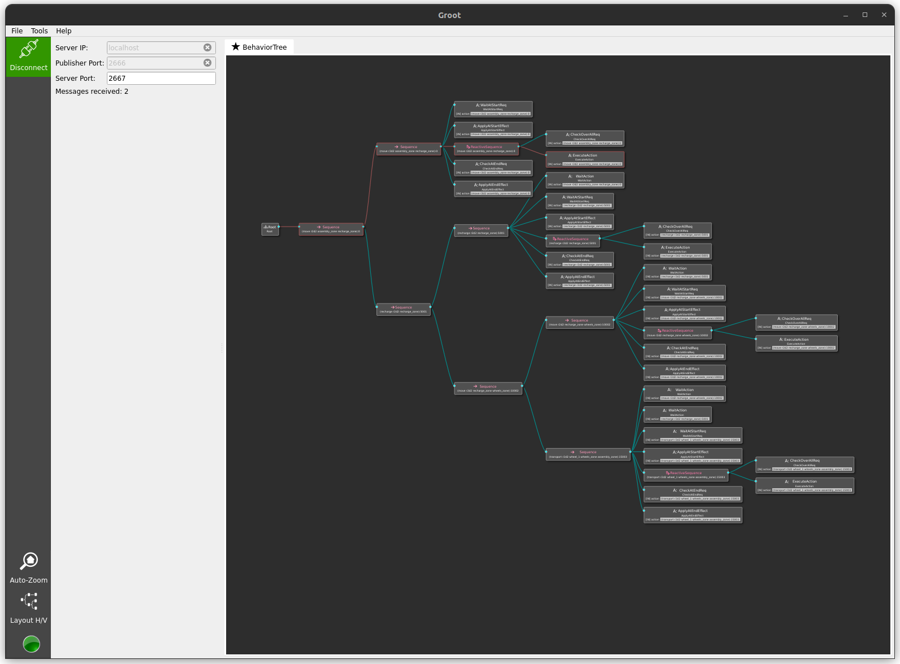

# PlanSys2 Behavior Tree Example

## Description

This example shows how to use Behavior Trees to carry out the tasks that an action requires. Each action has an xml file that defines a behavior tree.
- In `src` the actions are implemented.
- In `src / behavior_tree_nodes` BT nodes.

See https://github.com/IntelligentRoboticsLabs/ros2_planning_system/pull/27 for details.

## Prerequisites

Navigation uses [EasyNav](https://easynavigation.github.io): the `Move` BT node sends its goals
with `easynav_system::GoalManagerClient`. Without EasyNav, the package is built without `Move`
and `easynav_sim_node`.

## How to run

### In terminal 1:

```bash
source install/setup.bash
ros2 run plansys2_bt_example easynav_sim_node
```

This simulates EasyNav: each navigation takes 10 s, for several robots at once.

### In terminal 2:

```bash
source install/setup.bash
ros2 launch plansys2_bt_example plansys2_bt_example.launch.yaml
```

### In terminal 3:

There are two options in this example. First option is to use the plansys2 terminal. Secondly you can use the custom assemble controller. Both options are shown below.

```bash
source install/setup.bash

ros2 run plansys2_terminal plansys2_terminal
```

Enter it manually, line by line:

```text
set instance r2d2 robot
set instance recharge_zone zone
set instance wheels_zone zone
set instance steering_wheels_zone zone
set instance body_car_zone zone
set instance assembly_zone zone
set instance wheel_1 piece
set instance body_car_1 piece
set instance steering_wheel_1 piece
set predicate (robot_available r2d2)
set predicate (robot_at r2d2 assembly_zone)
set predicate (is_recharge_zone recharge_zone)
set predicate (piece_at wheel_1 wheels_zone)
set predicate (piece_at body_car_1 body_car_zone)
set predicate (piece_at steering_wheel_1 steering_wheels_zone)
set goal (and(piece_at wheel_1 assembly_zone))
run
```
You can also paste the problem above into a file (e.g. problem.txt), start the plansys2_terminal and enter the following:

```text
source problem.txt
```
Or use a custom controller:

```bash
source install/setup.bash
$HOME/dev_ws/build/plansys2_bt_example/assemble_controller_node
```
NOTE: this problem domain is different from example entered in the plansys2 terminal.

### In terminal 4 (optional):

NOTE: this is not working right now due to the upgrade to BT.CPP v4

To monitor the behaviortree in Groot, type the following to connect it to the plansys2 executor:
```bash
$HOME/dev_ws/build/groot/Groot --mode monitor --publisher_port 2666 --server_port 2667 --autoconnect
```

NOTE: best way is to run commands above just after you have followed the instructions as mentioned in `In terminal 3`.



## Variant: assembly with arms, to analyze parallel execution

`pddl/bt_arm_example.pddl` splits each trip into a long `move` and a short `approach`, and adds
an arm preparation before each pick (`prepare_pick`) and each release (`prepare_release`). The
preparation needs `(heading ?r ?z)`, which the **start** of `approach` makes true and which stays
true until the robot leaves, so the plan prepares the arm during the approach.

The executor turns the plan into a behavior tree with a BT builder:

* `SimpleBTBuilder` only waits for actions to **end**: it prepares the arm after the approach.
* `STNBTBuilder` follows the plan's time network, start and end of each action: it prepares the
  arm while the robot approaches.

Both complete the plan; the difference is how much of it runs in parallel. Navigation is
simulated: the launcher starts its own `easynav_sim_node` (do not run another one), so neither
a robot nor EasyNav has to run:

```
ros2 launch plansys2_bt_example plansys2_bt_arm_example.launch.yaml bt_builder:=stn  # or simple
ros2 run plansys2_bt_example assemble_arm_controller_node --ros-args -p cars:=3
```

The controller reports the planned and the actual time:

```
Plan with 25 actions, 35.0 s planned
Plan succesfully finished in 40.2 s
```
